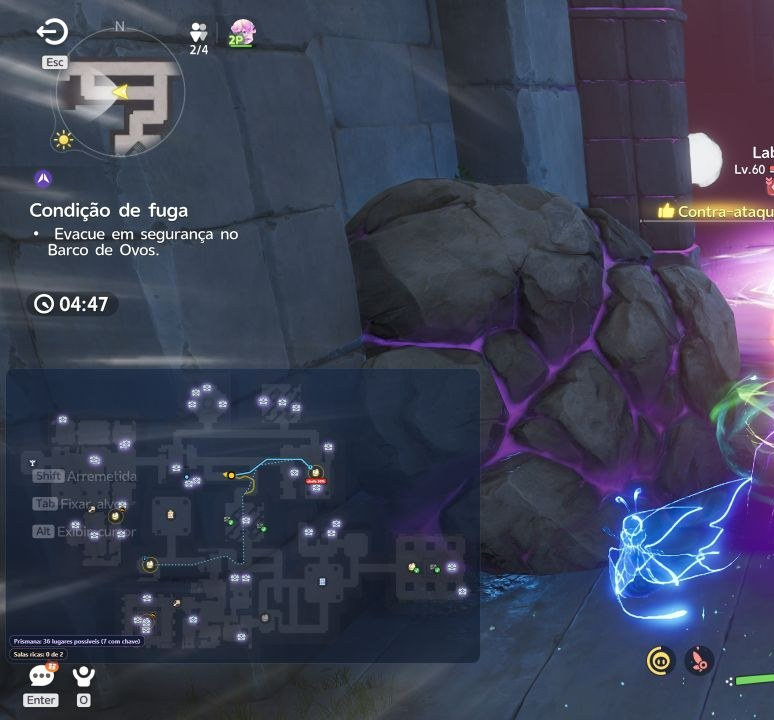
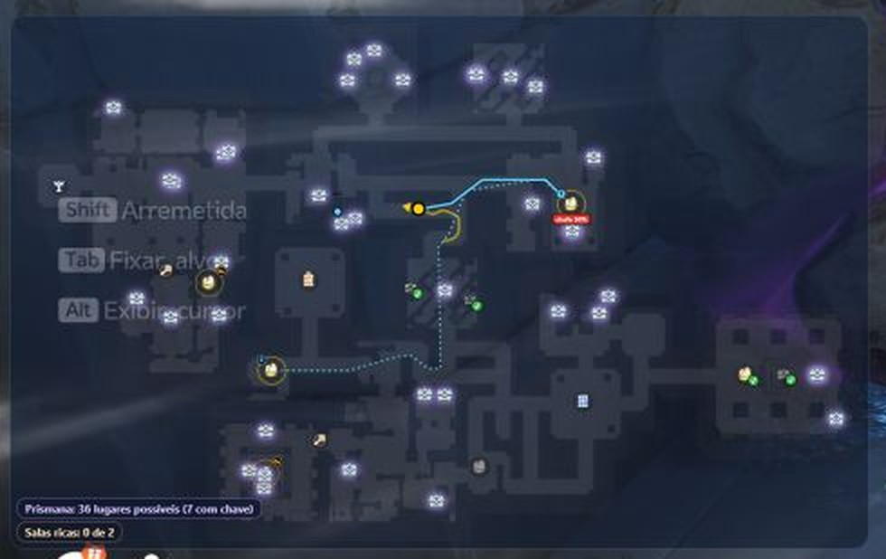

🇺🇸 [Read in English](README.md)

# AniiCompanion

**Um mapa ao vivo do Santuário Perdido no Roubo dos Ovos do Aniimo, desenhado por cima do seu jogo.**
Mostra onde você está, quais ninhos ainda podem ter ovo, os baús, o caminho da saída e os avisos de onda. O mapa da sua equipe é somado ao seu.

<p align="center">
  
</p>

<p align="center">
  <a href="https://github.com/companiion/aniicompanion-releases/releases/latest"><b>Baixar para Windows (última versão)</b></a>
</p>

<p align="center">
  <a href="https://companiion.github.io/aniicompanion-releases/">Site de ajuda</a>
</p>

Gratuito. Para Windows. Se atualiza com um clique. Projeto de fã, sem ligação com a Pawprint Studio / FunPlus.

---

## O que ele faz

- **Você no mapa, ao vivo.** Acha a sua posição no minimapa do jogo e mostra o santuário inteiro. O mapa pode girar com a câmera ou ficar com o norte para cima.
- **Ninhos e ovos.** Mostra onde ainda pode haver um ninho, a chance de cada lugar, quais ninhos você já revistou e os ovos largados no chão.
- **Baús raros e Prismana.** Mostra quais baús ainda podem dar um item Prismana e se atualiza conforme os baús são abertos.
- **Rota e avisos.** Uma linha guia você pelos ninhos que ainda não olhou. Você recebe a contagem das três ondas de monstros e da horda, e o aviso de "hora de voltar" com o caminho até a saída mais perto.
- **Andar de cima.** Ao subir a escada, as passarelas do andar de cima aparecem no mapa.
- **Mapa em janela pequena.** Prefere um mapa pequeno num canto? Troque para uma janela que você move e redimensiona.
- **Jogando com amigos.** Adicione amigos e veja onde eles estão. Ninhos, ovos e baús que eles acham aparecem no seu mapa também.
- **Atualização com um clique.** O app avisa quando há versão nova e a instala depois de conferir a assinatura do autor.

<p align="center">
  
</p>

## Requisitos

- Windows 11, 64 bits (testado). O Windows 10 deve funcionar, mas ainda não foi testado.
- Aniimo em **janela** ou **tela cheia sem bordas**. A tela cheia exclusiva não pode ser capturada, então o mapa não funciona nela.

## Instalar

1. Vá em [última versão](https://github.com/companiion/aniicompanion-releases/releases/latest) e baixe o arquivo `.zip`.
2. **Extraia a pasta inteira.** Não rode de dentro do zip.
3. Abra o `AniiCompanion.exe`. (O Windows pode avisar na primeira vez. Veja a próxima seção.)
4. Na primeira vez, o app pergunta o idioma (português ou inglês). Você pode trocar depois no botão de globo. Ele também baixa os mapas dos santuários, o que leva alguns segundos.
5. Abra o Aniimo em janela ou tela cheia sem bordas e entre no Roubo dos Ovos. O mapa aparece por cima do jogo, só dentro do santuário.
6. A dificuldade é detectada automaticamente pela meta de moedas do painel do jogo. Você não precisa configurar nada.

**Atualizar:** o app confere se há versão nova ao abrir e a cada 6 horas. Quando houver, aparece "Nova versão · Atualizar" no alto da janela. Clique e o app faz o resto. Suas configurações, amigos e mapas baixados continuam, e a versão anterior fica numa pasta chamada `AniiCompanion.anterior` ao lado do app.

**Desinstalar:** apague a pasta do app. Suas configurações e registros ficam em `%LOCALAPPDATA%\AniimoCompanion`. Apague essa pasta também se quiser remover tudo.


## O Windows avisou ou bloqueou?

O app é gratuito e **não tem certificado pago de assinatura de código**. O Windows avisa sobre todo programa assim, mesmo sem nada de errado. Os outros mapas do Aniimo e as ferramentas de outros jogos estão na mesma situação.

1. **"O Windows protegeu o computador"**: clique em **Mais informações** e depois em **Executar assim mesmo**. Normalmente só é preciso fazer isso uma vez. As atualizações feitas pelo próprio app não devem pedir de novo.
2. **O antivírus removeu o app**: abra Segurança do Windows, depois Proteção contra vírus e ameaças, depois **Histórico de proteção**. Ache o AniiCompanion, clique em **Ações** e em **Restaurar**. Se continuar acontecendo, adicione a **pasta** do AniiCompanion em **Exclusões** (a exclusão vale só para essa pasta, então não coloque outras coisas dentro dela).
3. **Controle Inteligente de Aplicativos (Smart App Control, Windows 11)**: com ele ligado, nenhum programa sem assinatura abre, e não há botão para liberar só um. **O app não funciona com ele ligado.** Desligar é decisão sua. Depois de desligado, o Windows não deixa ligar de novo sem reinstalar o Windows.

## Confira o seu download

A página de cada versão mostra o SHA-256 do zip. Para conferir o seu, abra o PowerShell na pasta do arquivo e rode:

```powershell
Get-FileHash .\AniiCompanion-<versão>-<código>.zip
```

Compare o resultado com o da página da versão. Se for diferente, não use o arquivo.

## Segurança e jogo limpo

O que o app **faz**: olha só a **imagem da janela do jogo**, como uma captura de tela, para achar você no minimapa.

O que o app **não faz**: não lê a memória do jogo, não injeta nada no jogo e não usa mods.

O Aniimo tem um sistema anti-cheat. Não falamos pelos desenvolvedores do jogo e não podemos prometer que nenhuma ferramenta jamais será sinalizada. Fizemos o app para não tocar em nada do jogo, mas **usá-lo é escolha sua e por sua conta e risco**.

## Privacidade: o que vai pela internet

Não pede conta. Não coleta nada que identifique você: nome, login, UID ou código de amigo. Se você aceitar, envia só informações de uso das partidas para melhorar o app; por enquanto, nada é enviado. Leia a [política de privacidade](https://companiion.github.io/aniicompanion-releases/privacidade.html). O app só fala com a internet para isto:

- **Atualizações:** confere este repositório do GitHub por versões novas e confere a assinatura do autor e o SHA-256 do arquivo antes de instalar qualquer coisa.
- **Mapas:** no primeiro uso, baixa os mapas dos santuários do [aniidex.com](https://aniidex.com) e os do andar de cima do [HideoutGacha](https://www.hideoutgacha.com).
- **Modo online (só se você usar):** fala só com os amigos que você adicionou, por relays públicos do Nostr. Os relays veem o seu IP e o horário, mas não o conteúdo, que vai cifrado. Com conexão direta, o amigo vê o IP de casa.
- **Botão "Salvar relatório":** só cria um arquivo `.zip` na pasta Downloads. Nada é enviado. Se algo der errado, você pode mandar esse arquivo para quem te passou o app. Ele leva os registros do app e algumas fotos da janela do jogo, então outras janelas abertas na hora podem aparecer nelas.

## Perguntas frequentes

**O mapa não aparece.**
Confira se o Aniimo está em janela ou tela cheia sem bordas. O mapa também só aparece dentro do santuário, e some sozinho quando você abre a bolsa, um baú ou um menu, e volta sozinho.

**Quais teclas ele usa?**
- `F1` mostra ou esconde o mapa.
- `Ctrl+F1` destrava a janelinha do mapa para você arrastar e redimensionar. Aperte de novo para travar, e os cliques passam para o jogo.
- `Ctrl+Shift+F1` reinicia o mapa se ele aparecer errado (ampliado, cortado, parado). A partida não se perde. O botão "Reiniciar mapa" do app faz o mesmo.

Enquanto o AniiCompanion está aberto, essas teclas são dele e não chegam ao jogo. Se outro programa já usa o F1 (por exemplo, outro mapa do Aniimo), feche-o antes.

**Em que idiomas o app está?**
Em português e em inglês. Você escolhe o idioma na primeira vez que abre o app e pode trocar quando quiser no botão de globo.

**Algo deu errado. E agora?**
Clique em "Salvar relatório" na janela do app e mande o `.zip` da pasta Downloads para quem te passou o app.

## Créditos e aviso

O AniiCompanion é um projeto de fã, gratuito. Aniimo é marca da Pawprint Studio / FunPlus. Este projeto não tem ligação com eles.

Este repositório guarda só as versões publicadas do app. Cada versão traz `AniiCompanion-<versão>-<código>.zip` (o app) e `manifest.json` e `manifest.json.sig`, que o app usa para se atualizar sozinho.
